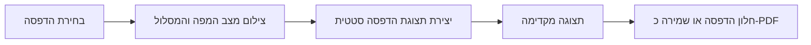

# תכנון: הדפסת מפות ומסלולי תחבורה ציבורית

**סטטוס:** הצעה לדיון  
**תאריך:** 29 באוקטובר 2026

## מטרה

לאפשר להפיק מהאפליקציה דף שימושי שאפשר להדפיס או לשמור כ־PDF:

1. מפה של האזור שמוצג כרגע, עם שכבות ומסלול פעיל לפי הצורך.
2. דף ניווט של מסלול בתחבורה ציבורית, עם מפת המסלול וסדר הנסיעה.

הפלט צריך להיות קריא גם בשחור־לבן, בעברית ובכיווניות RTL, ולכלול את המידע הדרוש בלי ממשק המפה, כפתורים או פרטי מסך שאינם שייכים להדפסה.

## המצב הקיים והשלכות

- המפה בנויה ב־MapLibre GL ומוצגת ב־`web/map.html`; יצירת המפה, הסגנונות והשכבות מנוהלות ב־`web/js/map.js`.
- תכנון המסלול נשמר ב־`Directions` שב־`web/js/directions.js`. במסלול רגיל יש חלופות, קו גאומטרי, זמן, מרחק והוראות נסיעה.
- תכנון תחבורה ציבורית מנוהל ב־`TransitPlanner` שב־`web/js/transit.js`. התוצאה מכילה חלופות, מקטעי הליכה ונסיעה, תחנות, קווים, זמנים וגאומטריה שמוצגת במפה.
- המפה ונתוני הבסיס מותקנים מקומית, לכן אפשר לתכנן הדפסה שעובדת גם ללא אינטרנט. אין לשלוח את המסלול או את מיקום המשתמש לשירות הדפסה חיצוני.
- במדריך הטיולים כבר קיימים כללי `@media print` ב־`web/css/guide.css`. זו דוגמה לניקוי הממשק בעת הדפסה, אבל מפה דורשת גם תמונת מפה יציבה ומסגרת עמוד.
- הקנבס של MapLibre הוא WebGL. אין להניח שצילום ישיר של הקנבס יישאר זמין או חד מספיק אחרי פתיחת חלון ההדפסה. גם אין להפעיל `preserveDrawingBuffer` בכל האפליקציה בלי מדידת השפעתו על ביצועים.

## חוויית משתמש מוצעת

### הדפסת המפה

1. המשתמש בוחר **הדפסת מפה** מתפריט פעולות המפה. אם מסלול כבר מוצג, הוא נכלל במפה.
2. נפתחת תצוגה מקדימה נקייה, ללא פקדי המפה. אפשר לבחור אם לכלול את המסלול, נקודות העניין והשכבות שמוצגות כרגע.
3. המשתמש ממשיך לחלון ההדפסה הרגיל של הדפדפן או של יישום שולחן העבודה, ובוחר מדפסת או שמירה כ־PDF.

ברירת המחדל היא דף A4 לרוחב, שמנצל את שטח הדף למפה. יש לשמור על יחס המפה ולהימנע מחיתוך הקצוות. אם המשתמש בוחר לאורך בחלון ההדפסה, יש להתאים את הפריסה בלי לחתוך את המפה.

תוכן דף המפה:

- מפה סטטית של תחום התצוגה הנוכחי, כולל הכיוון והזום.
- סוג המפה שנבחר ושכבות גלויות שנבחרו להכללה.
- קו המסלול הפעיל, אם קיים, ונקודות מוצא ויעד.
- שם אזור או כותרת שהמשתמש יכול לערוך; ברירת המחדל תהיה „מפת האזור”.
- סרגל קנה מידה וחץ צפון שמתעדכנים לפי זום וסיבוב המפה.
- מקרא רק לסימונים שמופיעים בפועל: סוגי קווים, סמני מוצא ויעד, וסימוני נקודות עניין אם נכללו.
- ייחוס ומקורות הנתונים הנדרשים, לפי שכבת המפה שנבחרה.
- תאריך הפקת הדף. אין להציג את התאריך כאילו הוא תאריך עדכון הנתונים.

יש להציע סגנון הדפסה בהיר וקריא כברירת מחדל. אם המשתמש בחר מפת לילה או תצלום לוויין, יש לאפשר להשאיר את הסגנון הנוכחי ולציין את הייחוס המתאים. אין לשנות את סגנון המפה באפליקציה עצמה כחלק מההדפסה.

### הדפסת מסלול בתחבורה ציבורית

כפתור **הדפסת המסלול** מופיע לאחר שנמצאה לפחות חלופה אחת. המשתמש בוחר חלופה ברשימה; הדף שיופק מתייחס לחלופה המסומנת בלבד, כפי שקורה בתצוגת הפרטים באפליקציה.

ברירת המחדל היא דף A4 לאורך, ובמסלול ארוך כמה עמודים עם כותרת חוזרת. תוכן הדף:

- כותרת מוצא ויעד, לפי שמות המקומות או התחנות.
- תאריך ושעת הנסיעה, והאם החיפוש היה לפי שעת יציאה או שעת הגעה.
- שעת יציאה והגעה, משך כולל, מספר החלפות ומרחק הליכה כולל.
- מפה קטנה של המסלול עם תחנות, קטעי הליכה וקווי הנסיעה. צבע הקו מלווה תמיד במספר קו או בשם, כדי שהמידע לא יהיה תלוי בצבע בלבד.
- פירוט כרונולוגי של כל מקטע: הליכה או קו, מפעיל אם קיים, כיוון, תחנת עלייה וירידה, שעות רלוונטיות וזמן או מרחק הליכה.
- יוצגו תחנות העלייה והירידה בלבד; תחנות ביניים לא יודפסו.
- ההערה הקיימת על כך שהזמנים משוערים לפי לוח זמנים, ולא נתוני זמן אמת. יש להציג גם אזהרה על נתוני לוח זמנים ישנים כאשר האפליקציה מציגה אזהרה כזו.
- ייחוס למקורות הנתונים.

יש למנוע פיצול של כותרת מקטע ופרטי התחנות שלו בין עמודים. במקרה של מעבר עמוד, יש לחזור על כותרת המסלול ועל פרטי הזמן כדי שהדפים יישארו מובנים בנפרד.

### מסלולי רכב, הליכה ואופניים

ההדפסה כוללת את קו המסלול הפעיל על גבי מפה בהירה וגם את הוראות הפנייה מתוך `r.steps`, כולל המרחקים שמספק שירות המסלולים.

### החלטות מימוש

- מפות ההדפסה משתמשות בסגנון בהיר, ללא קשר לסגנון המפה הפעילה.
- בתחבורה ציבורית יודפסו תחנות עלייה וירידה בלבד.
- במסלולי רכב והליכה יודפסו גם הוראות הפנייה. אותו מבנה זמין גם למסלול אופניים.

## מבנה טכני מוצע

מומלץ להפריד בין איסוף מצב המפה, יצירת תמונת מפה ופריסת המסמך:

1. **איסוף מצב:** ליצור אובייקט נתונים להדפסה מתוך `MapView`, `Directions` ו־`TransitPlanner`: תחום, זום, bearing, סגנון ושכבות גלויות, גאומטריית המסלול והפרטים המוצגים למשתמש. ההדפסה לא תשנה את מצב הניווט ולא תריץ מחדש חיפוש.
2. **רינדור מפה:** ליצור רינדור זמני בגודל וביחס המתאימים לנייר, עם הסגנון והשכבות שנבחרו, להמתין ל־MapLibre `idle`, ואז לייצא תמונת PNG. יש להשמיד את מופע הרינדור אחרי השימוש. יש לבדוק אם אפשר לשתף את הגדרות הסגנון והשכבות הקיימות בלי לשכפל את כל קוד `MapView`.
3. **פריסת הדפסה:** להציג מסמך HTML ייעודי או אזור הדפסה ייעודי עם CSS של `@media print`. לא להדפיס את מסך האפליקציה כולו ולא לכלול את פקדי המפה.
4. **הדפסה:** להפעיל `window.print()` מתוך תצוגת ההדפסה. המשתמש יוכל לבחור מדפסת או „שמירה כ־PDF” דרך מערכת ההפעלה. אין צורך בספריית PDF חיצונית בשלב הראשון.
5. **מצבי כשל:** להציג הודעה אם אין גאומטריית מסלול, אם נתוני המפה לא נטענו, או אם הדפדפן לא הצליח ליצור תמונת מפה. לא לפתוח עמוד ריק ולא להדפיס תצוגת מפה חלקית בלי הסבר.

הצעת הרינדור הזמני נועדה לא לשנות את הזום או הסגנון של המפה הפעילה, ולא להסתמך על תוכן WebGL שנמחק לפני צילום. לפני מימוש יש לבדוק שאפשר לשכפל את השכבות הדינמיות, במיוחד קווי תחבורה ציבורית ונקודות עניין, לתוך מופע זמני.

## היקף גרסה ראשונה

### כלול

- הדפסת תחום המפה הנוכחי, לרבות קו מסלול פעיל.
- בחירת שכבות להכללה ותצוגה מקדימה לפני הדפסה.
- דף מסלול עבור חלופת תחבורה ציבורית מסומנת, כולל מפה קטנה ופירוט מקטעים.
- תמיכה ב־A4 לאורך ולרוחב, ושמירה כ־PDF דרך חלון ההדפסה.
- RTL, עברית, נגישות מקלדת והדפסה ללא חיבור לאינטרנט לאחר שהמפה והנתונים נטענו.
- ייחוס מקורות ואזהרה על זמני תחבורה ציבורית משוערים.

### לא כלול בשלב הראשון

- בחירת שטח חדש לצילום באמצעות מסגרת על המפה.
- בחירת קנה מידה מספרי מדויק או גודל נייר מעבר לאפשרויות של חלון ההדפסה.
- הדפסת כל חלופות המסלול יחד.
- ייצוא PDF ישיר בלי חלון הדפסה.
- דף הוראות מפורט למסלול רכב, הליכה או אופניים.
- הדפסת לוחות יציאה חיים מתחנה; הנתונים באפליקציה מבוססים על לוח הזמנים שנטען.

## שלבי מימוש

1. **בדיקת היתכנות:** להפיק מפה זמנית באיכות הדפסה, עם קו מסלול ושכבות קיימות, בלי לשנות את המפה החיה. לבדוק ביצועים ותמיכה ב־Chromium וב־WebView של יישום שולחן העבודה.
2. **תשתית ותצוגה מקדימה:** לבנות `PrintView` נפרדת, טיפול במצבי טעינה/כשל, כותרת, ייחוס, קנה מידה וחץ צפון.
3. **מפת אזור:** להוסיף פעולה בתפריט המפה והעדפות שכבות, כולל מדיה בהירה והדפסת מסלול פעיל.
4. **מסלול תחבורה ציבורית:** להוסיף פעולה בכרטיס החלופה ולבנות תבנית שמציגה את פרטי `itinerary` ואת הגאומטריה שלו.
5. **ליטוש:** לבדוק עמודים קצרים וארוכים, צבע ושחור־לבן, עברית ומספרים, שוליים, קפיצות עמוד, תמיכה במקלדת והדפסה ללא אינטרנט.

## קריטריוני קבלה

- אפשר לפתוח הדפסה מהמפה ומחלופת תחבורה ציבורית שנבחרה.
- המפה המודפסת תואמת לתחום, לשכבות ולמסלול שנבחרו; שינוי ההדפסה לא מזיז או משנה את המפה הפעילה.
- מסלול התחבורה הציבורית כולל את כל המקטעים לפי סדר, עם תחנות, קווים וזמנים שתואמים לחלופה שנבחרה.
- דף המסלול מציין שהזמנים מבוססים על לוח הזמנים ואינם זמן אמת.
- אין כפתורים, תפריטים או חלוניות של האפליקציה בדף המודפס.
- מפה, מקרא וייחוס נשארים קריאים גם בשחור־לבן; אין מידע שמועבר בצבע בלבד.
- מסלול ארוך אינו נחתך, וכותרת של מקטע אינה נפרדת מהפרטים שלו.
- ההדפסה עובדת גם ביישום שולחן העבודה ובדפדפן, ו„שמירה כ־PDF” זמינה דרך חלון ההדפסה.
- כל ההדפסה נעשית מקומית, בלי העלאת מיקום או מסלול לשירות צד שלישי.

## החלטות שאושרו

- בתחבורה ציבורית יוצגו תחנות עלייה וירידה בלבד.
- במסלולי רכב והליכה יודפסו גם הוראות פנייה.
- מפת ההדפסה תהיה בהירה גם כשהמפה הפעילה מוצגת בסגנון אחר.
